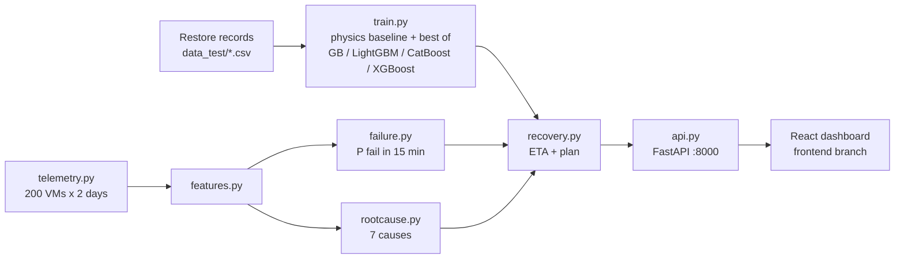

# GMCR: Global Multi-Cloud Recovery

**Threat-aware disaster-recovery forecasting for AWS, Azure and VMware.**

GMCR predicts how long a cloud restore will really take and why. It warns before a VM fails, diagnoses why
the VM went down, and recommends what to do first. It covers routine outages and cyber incidents such as
ransomware and wiper malware, where recovery is slowest.

> This `main` branch holds the Python backend: ML models, API, data and design docs.
> The React dashboard is on the [`frontend`](../../tree/frontend) branch.

---

## What it answers

| Question | How GMCR answers it |
|---|---|
| How long will recovery take? | Restore-time forecast (P50 likely, P90 worst realistic) |
| Why is it slower than `size ÷ bandwidth`? | Cloud friction = forecast minus the physics baseline, explained per feature with SHAP |
| What would make it faster? | What-if on controllable settings (disk tier, IOPS, region, restore method) |
| Where does it break as we grow? | Scalability curve from 10 GB to 5000 GB, with the SLA breach point |
| Will this VM fail soon? | Failure risk for the next 15 minutes from live metrics and events |
| Why did it go down? | Root cause from 7 causes (storage I/O, network, host, disk exhaustion, OS crash, app, security) |
| What should we do first? | Severity, priority, ETA and ordered recovery steps |
| What does it cost? | Downtime and friction cost in dollars |

## Architecture



## Results (held-out, synthetic data)

| Model | Result |
|---|---|
| Restore time, AWS (CatBoost) | MAE 1.8 min, R² 0.999 (5-fold CV) |
| Failure warning, elevated threshold | Caught 127 of 152 failures, median 14 min ahead |
| Root cause (XGBoost) | 99.7% accuracy in CV on training VMs |

Full numbers are in [models/model_card.json](models/model_card.json) and [models/ops_card.json](models/ops_card.json).

## Quick start (Windows)

```
git clone https://github.com/Piyush09159/GMCR.git
cd GMCR
python -m venv .venv
.venv\Scripts\python -m pip install -r requirements.txt
.venv\Scripts\python -m uvicorn gmcr.api:app --port 8000
```

The trained models are included. To retrain them:

```
.venv\Scripts\python -m gmcr.train        # restore-time models, about 90 s
.venv\Scripts\python -m gmcr.pipeline     # failure-risk and root-cause models, about 60 s
```

### Add the dashboard

```
git clone -b frontend https://github.com/Piyush09159/GMCR.git frontend
cd frontend && npm install && npx vite
```

Open http://localhost:5173. The API takes about 10 seconds to warm up the fleet replay when it starts.

## API

| Method | Path | Returns |
|---|---|---|
| GET | `/api/meta` | Platforms, inputs and defaults |
| POST | `/api/forecast` | P50/P90, friction, SHAP, what-if, scalability, cost |
| POST | `/api/report` | Executive PDF report |
| POST | `/api/scenarios/critical-path` | Application stack restore order and total time |
| POST | `/api/scenarios/chaos` | Restore time under an unstable network |
| POST | `/api/scenarios/multi-cloud` | The same restore on each cloud |
| GET | `/api/models` | Model comparison and quality metrics |
| GET | `/api/fleet/overview`, `/api/fleet/triage` | Fleet state over time and the triage list |
| GET | `/api/incidents`, `/api/incidents/{id}` | Held-out outages with risk, diagnosis and plan |

## Project layout

```
gmcr/            Python package: training, models, API, scenarios, PDF report, Terraform templates
data_test/       Restore records (AWS, Azure, VMware)
data_synthetic/  Simulated fleet telemetry and labelled incidents
models/          Trained models and model cards
tests/           pytest suite
docs/            Pipeline design, incident pipeline, backend notes, review
reports/         Demo report
```

## Tests

```
.venv\Scripts\python -m pytest -q
```

## Alignment with industry practice

- **Google Cloud disaster recovery guide.** GMCR covers RTO per application tier, combined RTO across
  dependent tiers, outage detection, regular DR testing (drill feedback and drift tracking), and cost
  against RTO.
- **NIST Cybersecurity Framework, Recover function (RC.RP).** Ransomware and wiper scenarios add isolation,
  forensics and clean-restore-point time to the forecast.

## Limitations

- Restore records and fleet telemetry are synthetic. Real logs with the same columns can replace the generator.
- GMCR forecasts restore time (RTO) only. It does not model RPO (data loss).
- GMCR models restore from backup. It does not model warm or hot standby failover.
- Supported platforms are AWS, Azure and VMware. GCP needs a restore dataset with the same columns.
