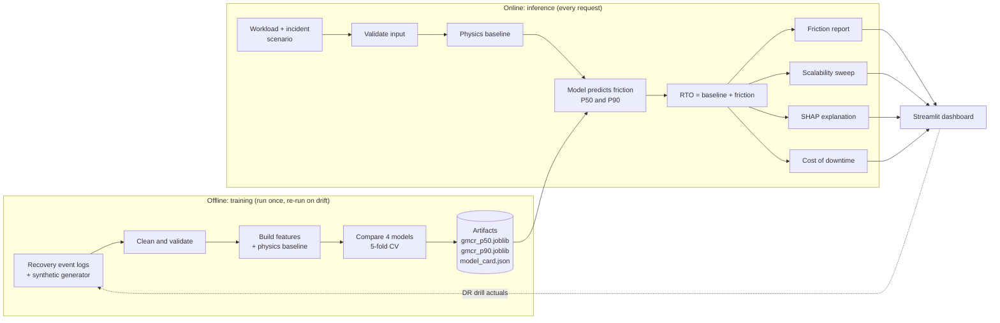

# GMCR Predictive Engine: Pipeline Design

**Global Multi-Cloud Recovery: threat-aware recovery time forecasting**
Hackathon theme: AI in cybersecurity and digital safety

---

## 1. What we are building

GMCR is a machine-learning system that predicts how long it will take to recover a cloud
workload after a disruption (the **Recovery Time Objective, RTO**). It does this far more
accurately than the naive `size ÷ bandwidth` estimate that teams normally use.

For every forecast it answers four questions:

| Question | Output |
|---|---|
| How long will recovery take? | RTO forecast, with a P50 (likely) and P90 (worst realistic) value |
| How much of that time is wasted? | **Cloud friction** = forecast − physics baseline |
| Where will it break as we grow? | Scalability curve from 10 GB to 5000 GB, with the SLA breach point |
| Why did the model say that? | Global feature importance and a per-prediction SHAP waterfall |
| What does it cost? | Downtime cost, friction cost and data-loss cost in dollars |

### Why this is a cybersecurity project

The original engine is a disaster-recovery tool. Outages are mostly non-malicious, so on its
own it reads as DevOps. We make it on-theme in two ways:

1. **Threat-aware recovery.** The incident type (hardware fault, misconfiguration, ransomware,
   wiper) is a model input. Attack recovery adds steps a normal failover does not have:
   isolating infected systems, forensic scanning, finding a clean restore point, and
   re-imaging. These are where recovery friction is worst.
2. **Breach impact in dollars.** A cost model turns RTO and friction into the financial loss
   of downtime, so the forecast supports a security budget decision.

This maps to the **Recover** function of the NIST Cybersecurity Framework (RC.RP: recovery
plan execution). It complements detection tools: they stop the attack, GMCR tells you how bad
the aftermath will be and what to fix before it happens.

---

## 2. Pipeline at a glance



Eleven stages, in order:

| # | Stage | Phase | Main output |
|---|---|---|---|
| 1 | Data sources and synthetic generator | Offline | `data/recoveries.csv` |
| 2 | Cleaning and validation | Offline | Clean training table |
| 3 | Feature engineering and physics baseline | Offline + online | Feature matrix, `baseline_min` |
| 4 | Model selection | Offline | Chosen algorithm and CV scores |
| 5 | Training and artifact generation | Offline | Two `.joblib` pipelines + model card |
| 6 | Live inference | Online | RTO P50 / P90 |
| 7 | Cloud friction | Online | Minutes and percent lost to friction |
| 8 | Scalability projection | Online | Curve + SLA breach point |
| 9 | Explainability | Online | Feature importance + SHAP waterfall |
| 10 | Threat scenarios and cost model | Online | Dollar impact per scenario |
| 11 | Serving, monitoring and retraining | Both | Dashboard, drift alerts |

---

## 3. Stage 1: Data sources

### Real sources (production)

| Source | What it gives us |
|---|---|
| AWS Backup / Elastic Disaster Recovery job logs | Restore start, end, bytes, region |
| Azure Site Recovery job history | Failover duration, VM size, target tier |
| GCP Backup and DR reports | Restore duration, storage class |
| Incident tickets (Jira, ServiceNow) | Incident type label, isolation and forensics time |
| DR drill records | Ground-truth RTO under controlled conditions |

### Hackathon source: synthetic generator

Real labelled recovery data, especially ransomware recoveries, is rare and private. For the
hackathon we generate it. The generator starts from the physics baseline and adds named,
documented friction terms, so every number in the dataset has a stated cause.

```python
# data/generate.py
import numpy as np, pandas as pd

rng = np.random.default_rng(42)
N = 20_000

TIERS = {"hdd": 1.6, "ssd": 1.15, "premium_ssd": 1.0}         # hydration multiplier
STORAGE = {"object": 1.3, "block": 1.0, "file": 1.2}
INCIDENT_OVERHEAD = {                                          # (fixed min, per-GB min)
    "hardware": (5, 0.000), "misconfig": (15, 0.000),
    "ransomware": (120, 0.020), "wiper": (180, 0.030),
}
REGIONS = ["us-east", "us-west", "eu-west", "ap-south", "me-central"]

def generate(n=N):
    df = pd.DataFrame({
        "vm_size_gb": rng.uniform(10, 5000, n).round(),
        "throughput_mb_s": rng.choice([50, 100, 250, 500, 1000], n),
        "disk_tier": rng.choice(list(TIERS), n),
        "target_storage_type": rng.choice(list(STORAGE), n),
        "source_region": rng.choice(REGIONS, n),
        "target_region": rng.choice(REGIONS, n),
        "concurrency": rng.integers(1, 64, n),
        "network_latency_ms": rng.gamma(2, 20, n).round(1),
        "api_throttle_rate": rng.beta(1, 9, n).round(3),
        "incident_type": rng.choice(list(INCIDENT_OVERHEAD), n, p=[.4, .3, .2, .1]),
        "clean_snapshot_age_h": rng.exponential(6, n).round(1),
    })
    base = df.vm_size_gb * 1024 / df.throughput_mb_s / 60
    fixed, per_gb = zip(*df.incident_type.map(INCIDENT_OVERHEAD))
    rto = (
        base * df.disk_tier.map(TIERS) * df.target_storage_type.map(STORAGE)
        * (1 + df.api_throttle_rate)                                   # throttling
        + df.network_latency_ms * 0.05                                 # handshakes / API RTT
        + np.log1p(df.concurrency) * 2                                 # coordination overhead
        + (df.source_region != df.target_region) * 10                  # cross-region
        + np.array(fixed) + np.array(per_gb) * df.vm_size_gb           # attack recovery steps
    ) * rng.lognormal(0, 0.1, n)                                       # noise
    df["actual_rto_min"] = rto.round(1)
    return df

if __name__ == "__main__":
    generate().to_csv("data/recoveries.csv", index=False)
```

> **Say this to judges up front.** On synthetic data the model learns the generator. The
> value we demonstrate is the pipeline: once real DR drill logs are fed in, nothing else
> changes. The friction constants above are assumptions, written down so they can be
> challenged and replaced.

---

## 4. Stage 2: Cleaning and validation

| Step | Rule | Why |
|---|---|---|
| Drop duplicates | Same job ID seen twice | Log replays |
| Drop impossible rows | `actual_rto_min < 0.9 × baseline_min` | Faster than physics allows means a logging error |
| Drop missing target | `actual_rto_min` is null | Cannot train on it |
| Outlier removal | IQR rule **within each `incident_type`** | A global IQR would delete every ransomware row, which is the signal we care about most |
| Schema check | Types, ranges, allowed categories | Fail loudly, not silently |

```python
def clean(df):
    df = df.drop_duplicates()
    df = df.dropna(subset=["actual_rto_min"])
    df = df[df.actual_rto_min >= 0.9 * physics_baseline(df)]
    q = df.groupby("incident_type").actual_rto_min.quantile
    lo, hi = q(.25), q(.75)
    iqr = hi - lo
    keep = df.actual_rto_min.between(
        df.incident_type.map(lo - 1.5 * iqr), df.incident_type.map(hi + 1.5 * iqr))
    return df[keep]
```

---

## 5. Stage 3: Feature engineering and the physics baseline

### Physics baseline

The theoretical "perfect vacuum" recovery time:

```
baseline_min = (vm_size_gb × 1024) / throughput_mb_s / 60
```

Units matter: size in **GB**, throughput in **MB/s** (megabytes). If a source reports Mbps
(megabits), divide it by 8 first.

Worked check: 500 GB at 100 MB/s → 500 × 1024 / 100 / 60 = **85.3 minutes**.

```python
def physics_baseline(df):
    return df.vm_size_gb * 1024 / df.throughput_mb_s / 60
```

### Feature schema

| Feature | Type | Notes |
|---|---|---|
| `vm_size_gb` | numeric | 10 to 5000 |
| `throughput_mb_s` | numeric | Effective restore throughput |
| `concurrency` | numeric | Parallel restore streams |
| `network_latency_ms` | numeric | Source to target RTT |
| `api_throttle_rate` | numeric | Share of API calls throttled, 0 to 1 |
| `clean_snapshot_age_h` | numeric | Age of the newest known-clean backup (RPO side) |
| `disk_tier` | categorical | hdd, ssd, premium_ssd |
| `target_storage_type` | categorical | object, block, file |
| `source_region`, `target_region` | categorical | |
| `cross_region` | derived bool | `source_region != target_region` |
| `incident_type` | categorical | hardware, misconfig, ransomware, wiper |
| `baseline_min` | derived numeric | Physics baseline, also given to the model |

### Target: predict the friction, not the RTO

**Design change from the original deck.** The model learns
`friction_min = actual_rto_min − baseline_min`, and we add the baseline back at prediction
time.

Why: tree models, including Gradient Boosting, **cannot extrapolate**. Past the largest VM
in the training data their prediction goes flat. Learning only the friction keeps the
physics part exact and linear at any size, so the 10 GB to 5000 GB sweep stays sensible. It
also means the cloud friction number comes straight from the model.

### Preprocessing

One scikit-learn `Pipeline` with a `ColumnTransformer`:

- Numeric: `StandardScaler`
- Categorical: `OneHotEncoder(handle_unknown="ignore")`

Saving the scaler and model as **one** pipeline artifact (instead of two separate files)
makes it impossible to load a mismatched pair.

> Scaling does not change a tree model's predictions. We keep it so the same preprocessing
> serves the linear regression baseline in the model comparison.

---

## 6. Stage 4: Model selection

All four candidates use the same features and 5-fold cross-validation.

| Candidate | Strength | Weakness | Role |
|---|---|---|---|
| Physics formula | Exact in a vacuum | Ignores all friction | Floor to beat |
| Linear regression | Fast, readable | Misses feature interactions | Baseline model |
| Random forest | Robust to noisy data | Overfits small datasets, larger files | Challenger |
| **Gradient Boosting** | Each round corrects the last round's errors; best accuracy on noisy tabular data | Needs tuning | **Chosen** |

Metrics reported for each: **MAE** (minutes, easy to explain), **RMSE** (punishes big
misses), **R²**.

Tuning with `RandomizedSearchCV` over:

| Hyperparameter | Range |
|---|---|
| `n_estimators` | 200 to 800 |
| `learning_rate` | 0.02 to 0.2 |
| `max_depth` | 2 to 5 |
| `subsample` | 0.7 to 1.0 |
| `min_samples_leaf` | 5 to 50 |

### Two models, not one

A failover decision needs the worst realistic case, not only the average. We train:

- **P50 model**: `loss="squared_error"`, the likely RTO
- **P90 model**: `loss="quantile", alpha=0.9`, the RTO we beat 9 times in 10

The P90 value is the one to compare against the SLA.

---

## 7. Stage 5: Training and artifact generation

```python
# gmcr/train.py
import json, joblib, datetime as dt
import pandas as pd
from sklearn.compose import ColumnTransformer
from sklearn.preprocessing import StandardScaler, OneHotEncoder
from sklearn.pipeline import Pipeline
from sklearn.ensemble import GradientBoostingRegressor
from sklearn.model_selection import train_test_split
from sklearn.metrics import mean_absolute_error, r2_score
from gmcr.features import NUM, CAT, add_features, clean

df = add_features(clean(pd.read_csv("data/recoveries.csv")))
X, y = df[NUM + CAT], df.actual_rto_min - df.baseline_min      # target = friction
X_tr, X_te, y_tr, y_te = train_test_split(X, y, test_size=0.2, random_state=42,
                                          stratify=df.incident_type)

def make(**gbr):
    pre = ColumnTransformer([("num", StandardScaler(), NUM),
                             ("cat", OneHotEncoder(handle_unknown="ignore"), CAT)])
    return Pipeline([("pre", pre), ("gbr", GradientBoostingRegressor(random_state=42, **gbr))])

p50 = make(n_estimators=500, learning_rate=0.05, max_depth=4).fit(X_tr, y_tr)
p90 = make(n_estimators=500, learning_rate=0.05, max_depth=4,
           loss="quantile", alpha=0.9).fit(X_tr, y_tr)

pred = p50.predict(X_te)
card = {
    "trained_at": dt.datetime.now().isoformat(timespec="seconds"),
    "rows": len(df), "features": NUM + CAT, "target": "friction_min",
    "mae_min": round(mean_absolute_error(y_te, pred), 2),
    "r2": round(r2_score(y_te, pred), 3),
    "p90_coverage": round(float((y_te <= p90.predict(X_te)).mean()), 3),  # should be near 0.90
    "train_size_range_gb": [float(X.vm_size_gb.min()), float(X.vm_size_gb.max())],
}
joblib.dump(p50, "models/gmcr_p50.joblib")
joblib.dump(p90, "models/gmcr_p90.joblib")
json.dump(card, open("models/model_card.json", "w"), indent=2)
```

Artifacts:

| File | Contents |
|---|---|
| `models/gmcr_p50.joblib` | Preprocessing + P50 model, one object |
| `models/gmcr_p90.joblib` | Preprocessing + P90 model, one object |
| `models/model_card.json` | Training date, row count, features, MAE, R², P90 coverage, size range |

Pass/fail gate before an artifact ships:

- MAE beats the physics formula's MAE by a clear margin.
- P90 coverage is between 0.85 and 0.95.
- R² on the held-out set is reported on the dashboard, whatever it is.

---

## 8. Stage 6: Live inference

1. The user defines a **workload vector**: VM size, throughput, disk tier, storage type,
   regions, concurrency, latency, throttle rate, incident type, clean snapshot age.
2. **Validate input** at the boundary: positive sizes, throughput > 0, known categories,
   size inside the range in the model card (warn when outside).
3. Compute the **physics baseline**.
4. Run the vector through both pipelines to get friction P50 and P90.
5. **RTO = baseline + friction.**

```python
# gmcr/predict.py
import joblib, pandas as pd
from gmcr.features import add_features

P50 = joblib.load("models/gmcr_p50.joblib")
P90 = joblib.load("models/gmcr_p90.joblib")

def forecast(workload: dict) -> dict:
    df = add_features(pd.DataFrame([workload]))
    base = float(df.baseline_min.iloc[0])
    f50, f90 = float(P50.predict(df)[0]), float(P90.predict(df)[0])
    return {"baseline_min": base,
            "rto_p50_min": base + f50, "rto_p90_min": base + f90,
            "friction_min": f50, "friction_pct": f50 / (base + f50)}
```

---

## 9. Stage 7: Cloud friction

```
Cloud friction = AI forecast − physics baseline
```

This isolates the time lost purely to cloud inefficiency and attack-recovery steps:
throttling, TCP handshakes, API latency, disk hydration, cross-region hops, forensic
isolation. Teams rarely see this number.

Report it three ways:

- **Minutes**: `friction_min`
- **Share**: `friction_pct`, the part of the outage that is overhead, not data transfer
- **Dollars**: see stage 10

If the model ever returns negative friction (forecast below physics), show it as 0 and flag
the input as out of distribution. Physics is a hard floor.

---

## 10. Stage 8: Scalability projection

Feed dummy VM sizes from 10 GB to 5000 GB through the model, holding every other input at the
user's values, and plot the RTO curve.

```python
import numpy as np

def sweep(workload, rto_target_min, sizes=np.linspace(10, 5000, 100)):
    rows = [forecast({**workload, "vm_size_gb": s}) for s in sizes]
    p90 = np.array([r["rto_p90_min"] for r in rows])
    breach = sizes[np.argmax(p90 > rto_target_min)] if (p90 > rto_target_min).any() else None
    return rows, breach
```

Two findings on the chart:

- **SLA breach point**: the first size where P90 RTO exceeds the RTO target. This is the
  tipping point where the current architecture stops meeting its promise.
- **Friction share curve**: if friction share climbs with size, the bottleneck is the platform,
  not bandwidth, and buying more bandwidth will not fix it.

Shade the part of the curve beyond the training size range in the model card as
"extrapolated".

---

## 11. Stage 9: Explainability

The model must justify a failover decision, so it is never a black box.

**Global: feature importance.** Rank which inputs drive friction most across all recoveries.
Expected leaders: target storage type, region pair, concurrency, data volume, network latency,
and incident type once the threat layer is in.

**Local: SHAP waterfall.** For one forecast, `shap.TreeExplainer` shows how much each feature
pushed friction above or below the average.

```python
import shap

def explain(workload):
    df = add_features(pd.DataFrame([workload]))
    pre, gbr = P50.named_steps["pre"], P50.named_steps["gbr"]
    Xt = pre.transform(df)
    names = pre.get_feature_names_out()
    sv = shap.TreeExplainer(gbr)(Xt.toarray() if hasattr(Xt, "toarray") else Xt)
    sv.feature_names = list(names)
    return sv[0]          # pass to shap.plots.waterfall
```

Because the target is friction, SHAP explains **the friction**, which is the part a team can
act on. The physics baseline needs no explanation.

---

## 12. Stage 10: Threat scenarios and the cost model

### Threat scenarios

The same workload is forecast under each incident type, side by side:

| Scenario | Extra recovery steps modelled |
|---|---|
| Hardware fault | Failover only |
| Misconfiguration | Diagnose, roll back config, failover |
| Ransomware | Isolate, forensic scan, find a clean restore point, re-image, restore |
| Wiper | All of the above, plus rebuild from older backups because recent ones are destroyed |

`clean_snapshot_age_h` drives the data-loss side: after ransomware, the newest backup may be
encrypted too, so recovery falls back to an older clean one.

### Cost model

All rates are **user inputs**. We do not hard-code industry averages.

```python
# gmcr/cost.py
def cost(rto_min, friction_min, snapshot_age_h, *,
         cost_per_hour, data_value_per_hour, rto_target_min, sla_penalty):
    downtime = rto_min / 60 * cost_per_hour
    data_loss = snapshot_age_h * data_value_per_hour                 # RPO side
    penalty = sla_penalty if rto_min > rto_target_min else 0
    return {"downtime_cost": downtime,
            "friction_cost": max(friction_min, 0) / 60 * cost_per_hour,  # the avoidable part
            "data_loss_cost": data_loss, "sla_penalty": penalty,
            "total": downtime + data_loss + penalty}
```

`friction_cost` is a subset of `downtime_cost`, so it is not added to the total. It is the
headline number: money that architecture changes could save.

### Worked example (illustrative inputs, not model output)

| Input | Value |
|---|---|
| VM size | 500 GB |
| Throughput | 100 MB/s |
| Scenario | Ransomware |
| Cost of downtime | $20,000 per hour |

| Result | Value |
|---|---|
| Physics baseline | 85.3 min |
| Forecast RTO (P50) | 212.0 min |
| Cloud friction | 126.7 min (60% of the outage) |
| Downtime cost | $70,667 |
| Friction cost (avoidable) | $42,233 |

---

## 13. Stage 11: Serving, monitoring and retraining

### Serving

One **Streamlit** app (`app.py`) loads the artifacts once and has four tabs:

1. **Forecast**: inputs on the left; baseline, P50, P90 and friction on the right.
2. **Scalability**: the sweep chart with the SLA breach point marked.
3. **Explain**: SHAP waterfall and global feature importance.
4. **Attack and cost**: the four scenarios side by side, with dollars.

A REST API (FastAPI) is not needed for the hackathon demo. Add it only if another system must
call the engine.

### Monitoring and retraining

- Log every forecast with its inputs.
- After each DR drill or real incident, record the actual RTO next to the forecast.
- Retrain when rolling MAE drifts more than 25% above the model card MAE, or when a new
  region, tier or incident type appears.
- Every retrain writes a new model card. Keep the previous artifacts for rollback.

---

## 14. Repository layout

```
gmcr/
├── data/
│   ├── generate.py          # stage 1: synthetic generator
│   └── recoveries.csv
├── gmcr/
│   ├── features.py          # stages 2-3: NUM, CAT, clean(), physics_baseline(), add_features()
│   ├── train.py             # stages 4-5
│   ├── predict.py           # stages 6-8: forecast(), sweep()
│   ├── explain.py           # stage 9
│   └── cost.py              # stage 10
├── models/
│   ├── gmcr_p50.joblib
│   ├── gmcr_p90.joblib
│   └── model_card.json
├── tests/
│   └── test_core.py
├── app.py                   # stage 11: Streamlit dashboard
└── requirements.txt         # pandas, numpy, scikit-learn, shap, streamlit, joblib, pytest
```

### Minimum tests

```python
# tests/test_core.py
import pandas as pd
from gmcr.features import physics_baseline
from gmcr.cost import cost

def test_physics_baseline():
    df = pd.DataFrame({"vm_size_gb": [500], "throughput_mb_s": [100]})
    assert round(physics_baseline(df).iloc[0], 1) == 85.3

def test_friction_cost_not_double_counted():
    c = cost(120, 60, 0, cost_per_hour=1000, data_value_per_hour=0,
             rto_target_min=999, sla_penalty=0)
    assert c["downtime_cost"] == 2000 and c["friction_cost"] == 1000 and c["total"] == 2000

def test_forecast_never_below_physics():
    from gmcr.predict import forecast
    r = forecast({...})  # fill with one valid sample workload
    assert r["rto_p50_min"] >= 0.9 * r["baseline_min"]
```

---

## 15. Build order for the hackathon

1. `features.py`: schema, `physics_baseline()`, `clean()`. Write the baseline test.
2. `generate.py`: produce 20,000 rows. Plot RTO against size per incident type to sanity-check.
3. `train.py`: compare the four models, print the CV table, save artifacts and model card.
4. `predict.py`: `forecast()` and `sweep()`.
5. `explain.py`: SHAP waterfall for one sample.
6. `cost.py`: cost model and its test.
7. `app.py`: four tabs, built in the order above.
8. Rehearse the demo.

## 16. Demo script (3 minutes)

1. **The problem**: "Your runbook says 85 minutes to restore this 500 GB server. That is the
   physics formula. It assumes a perfect vacuum."
2. **The forecast**: switch the scenario to ransomware. "GMCR says 212 minutes. 127 of them are
   friction: isolation, forensics, throttling. At $20,000 an hour, that friction costs
   $42,000."
3. **The why**: open the SHAP waterfall. "Object storage as the target and the cross-region
   hop account for most of it. Those are fixable."
4. **The future**: open the scalability tab. "At 1.8 TB, this architecture breaks your
   4-hour SLA. You know that today, before an attacker teaches you."

(The numbers above are illustrative. Use the real dashboard output on the day.)

## 17. Questions judges will ask

| Question | Answer |
|---|---|
| "Is the data real?" | Synthetic, from a documented generator. The pipeline is the product; it trains on real DR logs unchanged. |
| "Why Gradient Boosting?" | Best accuracy on noisy tabular data in our CV comparison; fast; SHAP has an exact tree explainer for it. |
| "Trees cannot extrapolate. How does the sweep reach 5000 GB?" | The model predicts friction only; the physics baseline carries the size scaling. We also mark the extrapolated region. |
| "Where is the security?" | The incident type is a model input, attack recovery steps are modelled, and the output is breach cost. It covers the NIST CSF Recover function. |
| "Why should I trust one number?" | We show P50 and P90, the held-out MAE, and a SHAP breakdown for every forecast. |
