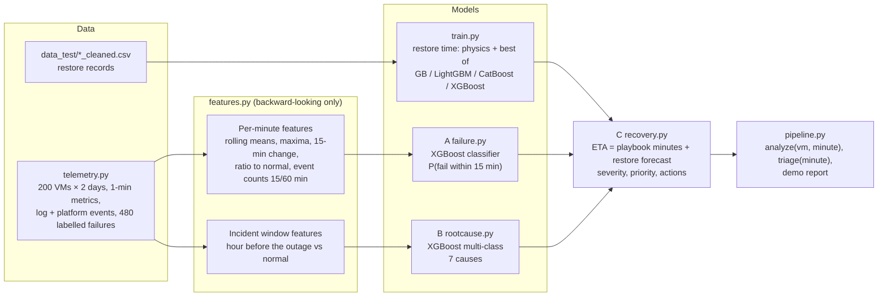

# GMCR Incident Pipeline

Three capabilities on top of the restore-time models:

| | Question | Output example (from `reports/demo_report.md`) |
|---|---|---|
| **A** | Will this VM fail in the next 15 minutes? | "High risk of failure within the next 15 minutes (94%). Signals: network errors at 5.0× normal; 1 failed health check; 4 earlier failures on this VM." |
| **B** | Why did this VM go down? | "Likely cause: storage I/O failure (99%); supporting evidence: disk latency peaked at 8.3× normal, 5 disk I/O errors in the last hour." |
| **C** | How long to recover, and what first? | "Restore ETA: 103 minutes (P90 105); investigate storage first; restore the disk onto healthy storage; prepare an alternative recovery target." |

> **Data is synthetic.** No real monitoring data, logs or failure labels were available. `gmcr/telemetry.py`
> simulates a fleet from documented failure mechanisms. The pipeline is the product: real telemetry with the
> same columns can replace the generator without changing A, B or C.

---

## 1. Pipeline



### Run

```
.venv/Scripts/python -m gmcr.train      # restore-time models (about 90 s)
.venv/Scripts/python -m gmcr.pipeline   # telemetry + A + B + demo report (about 60 s)
.venv/Scripts/python -m pytest -q       # 21 tests (about 20 s)
```

`python -m gmcr.pipeline --regenerate` rebuilds the synthetic telemetry.

### Python entry points

| Call | Returns |
|---|---|
| `pipeline.analyze(tel, risk_model, cause_model, vm_id, minute)` | `{"risk", "diagnosis", "plan"}` for one VM; diagnosis only when the VM is down |
| `pipeline.triage(tel, risk_model, cause_model, minute)` | Down or at-risk VMs, highest priority first |
| `failure.assess(...)` | Probability, band (Low / Elevated / High / Down), signals, message |
| `rootcause.diagnose(...)` | Ranked causes with probabilities, evidence, message |
| `recovery.plan(...)` | Severity, priority score, ETA P50/P90, steps, message |
| `predict.predict(platform, config)` | Restore P50/P90, physics baseline, friction |

---

## 2. Data (synthetic)

| Table | Columns |
|---|---|
| `fleet.csv` | vm_id, platform, tier (critical/standard/low), hist_failures, restore_config (a real row from the restore data) |
| `metrics.parquet` | vm_id, minute, cpu_pct, mem_pct, disk_latency_ms, disk_free_pct, net_err_per_min, health_ok, is_down |
| `events.parquet` | vm_id, minute, source (os/platform/app/auth/security), code, message |
| `incidents.csv` | incident_id, vm_id, platform, cause, precursor_start, fail_minute, recover_minute, strength |

Failure mechanisms (all assumptions):

| Cause | Warning time | Precursor | At failure |
|---|---|---|---|
| Disk exhaustion | 30–120 min | Free disk falls to ~0, `ENOSPC` errors | `ENOSPC`, often app crash |
| Storage I/O | 15–60 min | Disk latency up to 16×, `DISK_IO_ERR` | I/O errors, read-only filesystem |
| Network | 10–40 min | Network errors, timeouts, failed health checks | Link down |
| Host | 0–8 min | Often none; sometimes one host-degraded event | Host-degraded event |
| OS crash | 20–90 min | Memory climbs toward 98%, OOM kills | Kernel panic |
| Application | 10–30 min | HTTP 5xx, CPU shift, health-check flaps | Service exit |
| Security | 20–60 min | Failed-login bursts, CPU toward 95%, alerts | Security alert |

To keep the problem honest: each incident's signal strength varies (0.4–1.0), benign episodes (CPU spikes,
latency spikes, network bursts, scanner logins) occur about 1.5 times a day per VM, and background log noise
runs all the time. VMs with more past failures fail more often.

---

## 3. Models and results

All results are on **60 held-out VMs** (30% of the fleet, never seen in training).

### A. Failure risk (XGBoost classifier)

- Features: 52 per minute, from the current minute and before. A test confirms features computed on data
  cut off at minute *x* equal the full-data features at *x*.
- Label: a failure starts within the next 15 minutes (1.4% of minutes).

| Metric | XGBoost | Logistic baseline |
|---|---|---|
| PR-AUC | **0.62** | 0.54 |
| ROC-AUC | 0.89 | 0.89 |

| Threshold | Failures warned in time | Median warning | False alert episodes per VM-day |
|---|---|---|---|
| Elevated (≥ 20%) | 127/152 (84%) | 14 min | 0.40 |
| High (≥ 50%) | 118/152 (78%) | 11 min | 0.12 |

By cause at Elevated: disk exhaustion, network and security 100%, storage 96%, application 92%, OS crash 88%,
**host 0%**. Host failures give no warning by design. Say so.

### B. Root cause (XGBoost multi-class)

- Features: 38 from the hour before the outage, compared with the VM's normal level.
- Held-out accuracy **98.7%**, top-2 accuracy 100%, macro F1 0.98 (majority-class guess: 18%).
- Host issues are the weakest (89% recall).
- Evidence is the top contributing features (XGBoost SHAP values), kept only when the value is clearly
  abnormal (for example, 3+ HTTP 5xx errors, not 1).

This accuracy is high because the synthetic logs contain clear terminal messages. Expect lower accuracy on
real logs, where causes overlap.

### C. Recovery ETA and actions

- **Restore forecast:** physics baseline + the best restore model per platform. After adding XGBoost to the
  comparison, CatBoost still wins on all three platforms (CV MAE: AWS 1.8, Azure 5.6, VMware 20.2 min;
  XGBoost 2.6, 7.1, 37.2).
- **ETA** = playbook minutes for the likely cause + restore forecast when the cause needs a restore.
  Security adds forensic imaging (0.02 min/GB). Playbook minutes are assumptions.
- **Alternative recovery target:** recommended for storage, host and security causes, when the top cause is
  below 50% confidence, or when P90 exceeds the SLA (240 min default).
- **Severity:** SEV1 = down and (critical tier or security); SEV2 = down; SEV3 = Elevated/High risk; SEV4 = low.
- **Priority score** = tier weight (3/2/1) × state (1 if down, else risk) × (1 + min(P90 ÷ SLA, 3)),
  × 1.5 for security.

| Cause | Investigate first | Action | Full restore? |
|---|---|---|---|
| Disk exhaustion | disk usage | extend volume or free space, restart | No (20 min) |
| Storage I/O | storage | restore onto healthy storage | Yes (+15 min) |
| Network | network path | fail over, reattach NIC | No (25 min) |
| Host | the host | redeploy onto a healthy host | Yes (+10 min) |
| OS crash | OS memory, kernel logs | reboot; restore if it recurs | No (15 min) |
| Application | recent deploys, error logs | roll back, restart | No (20 min) |
| Security | the security incident | isolate, preserve evidence, rebuild from clean snapshot | Yes (+120 min + forensics) |

---

## 4. Files

| Path | Purpose |
|---|---|
| `gmcr/telemetry.py` | Synthetic fleet generator; load/save |
| `gmcr/features.py` | Per-minute and incident-window features; datasets |
| `gmcr/explain.py` | Evidence wording from SHAP contributions |
| `gmcr/failure.py` | A: train, evaluate, `assess` |
| `gmcr/rootcause.py` | B: train, evaluate, `diagnose` |
| `gmcr/recovery.py` | C: playbook, `eta`, `plan` |
| `gmcr/pipeline.py` | End-to-end run, `analyze`, `triage`, demo report |
| `models/failure_risk.joblib`, `models/root_cause.joblib` | Trained A and B |
| `models/ops_card.json`, `models/root_cause_confusion.csv` | Metrics |
| `reports/demo_report.md` | One held-out incident per cause, plus a fleet triage table |
| `tests/test_incidents.py` | 9 tests for A, B, C |

## 5. Limits

- Synthetic data: the models learn the generator's mechanisms. Replace `telemetry.py` output with real
  metrics and logs to make the numbers meaningful.
- Playbook minutes, incident overhead and severity weights are assumptions, not learned.
- Host failures cannot be predicted from these signals.
- One VM per analysis; no dependencies between VMs in triage.
